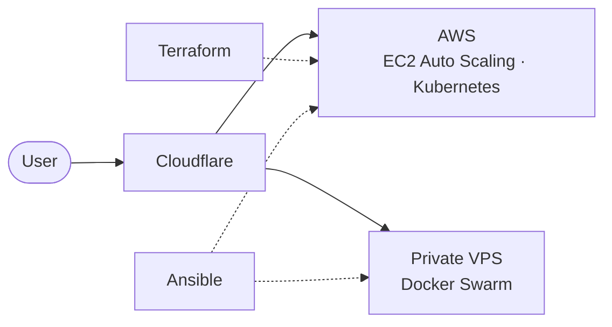

# Alexander Garcia

**I build frontend, backend and infrastructure.**
Software engineer in Mexico. Currently on the founding team at [Nuke AI](https://nuke-ai.com/), building complete systems and landing pages, running the infrastructure, and shipping automations and bots with n8n and AI.

[Portfolio](https://alexandergv2117.dev) · [LinkedIn](https://www.linkedin.com/in/alexander-garcia-vizcarra-329765257/) · [Email](mailto:alexandergv2117@gmail.com) · [Español](https://alexandergv2117.dev/es/)

## What I build

| Frontend | Backend | Infrastructure |
| --- | --- | --- |
| React, Next.js, Tailwind CSS, Astro | Node.js, NestJS, Go, PostgreSQL | Docker Swarm, AWS (EC2 + Auto Scaling), Kubernetes, Terraform, Ansible |

  

Also: Traefik, Envoy, Cloudflare, n8n.

## How it runs

The same app can run on private VPS servers with Docker Swarm, on AWS EC2 inside an Auto Scaling Group, or on Kubernetes in AWS. Ansible configures the servers and Terraform builds everything on AWS.

Interactive versions of seven architectures, from Next.js + PostgreSQL to the full setup, are in the [Architecture Lab](https://alexandergv2117.dev/#architecture-lab) on my portfolio.

## Experience

- **Nuke AI**, Sept 2025 to present, remote. Founding team: systems, landing pages, infrastructure, n8n and AI bots.
- **Dwit México**, 2025. Moved scattered hosting to one VPS with Docker Swarm and Traefik; costs dropped about 50%.
- **Capital 28**, 2023 to 2025. Led a backend migration from monolith to microservices; Firebase auth with Cerbos (ABAC).
- **Wizeline**, 2022 to 2023. Internal recognition platform; upgraded Node.js 12/14 to 18.

## Contact

Tell me what you're building and where it hurts: [alexandergv2117@gmail.com](mailto:alexandergv2117@gmail.com)

---

**ES:** Ingeniero de software. Construyo frontend, backend e infraestructura. Más en [alexandergv2117.dev/es](https://alexandergv2117.dev/es/).
