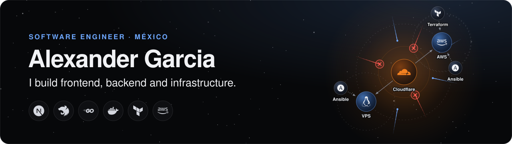
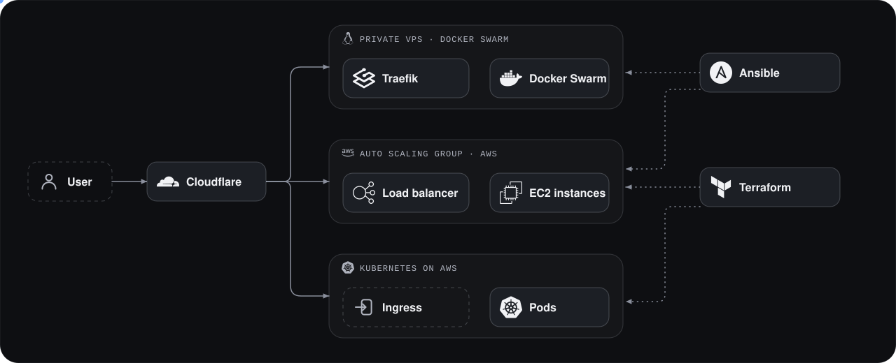

 

 

On the founding team at **[Nuke AI](https://nuke-ai.com/)**, building complete systems and landing pages, running the infrastructure, and shipping automations and bots with n8n and AI.

## Where the same app runs

Seven interactive architectures, from Next.js + PostgreSQL to this full setup, live in the **[Architecture Lab](https://alexandergv2117.dev/#architecture-lab)**.

## Experience

| | | |
| --- | --- | --- |
| **Nuke AI** 🟢 | Founding team · remote | Sept 2025 – present |
| **Dwit México** | Full Stack Developer | 2025 · moved scattered hosting to one VPS with Docker Swarm, costs down about 50% |
| **Capital 28** | Backend Developer | 2023 – 2025 · monolith to microservices, Firebase auth with Cerbos (ABAC) |
| **Wizeline** | Full Stack Intern | 2022 – 2023 · internal recognition platform, Node.js 12/14 to 18 |

 

**Tell me what you're building and where it hurts.**
[alexandergv2117@gmail.com](mailto:alexandergv2117@gmail.com)

**ES:** Ingeniero de software. Construyo frontend, backend e infraestructura. Más en [alexandergv2117.dev/es](https://alexandergv2117.dev/es/).

